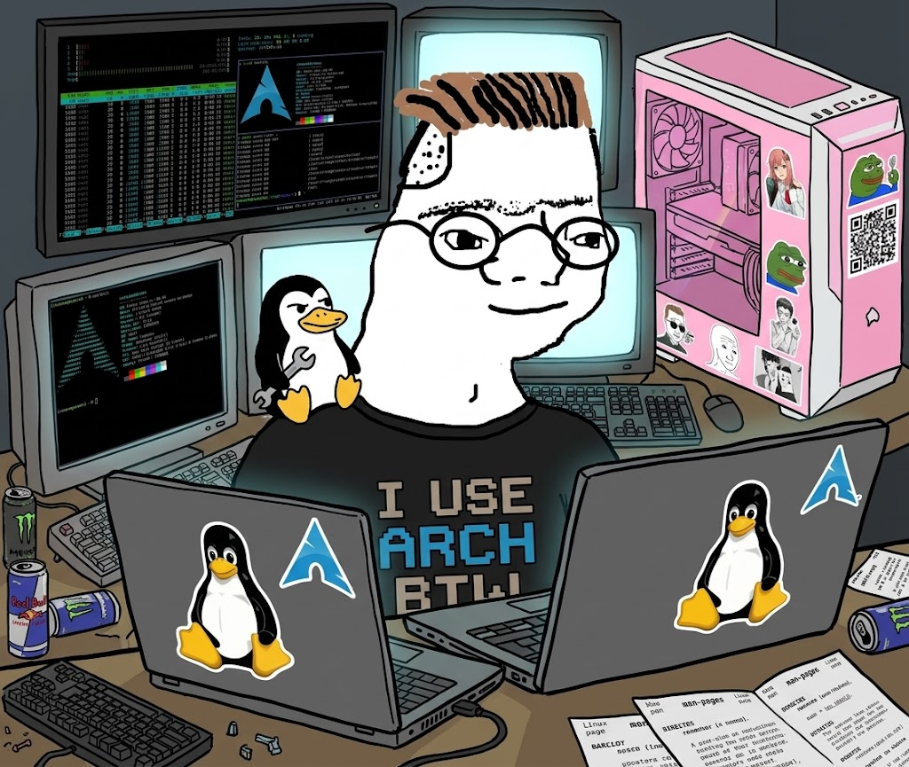

<p align="center">
  
</p>

<h1 align="center">Zoomer Linux Survival</h1>

<p align="center">
  <b>Curso interactivo de Linux en español</b><br />
  Cátedra de Sistemas Operativos II
</p>

---

## Qué tipo de proyecto es

Una **aplicación web estática** que enseña a usar la línea de comandos de Linux
practicando de verdad, no leyendo sobre el tema.

No es un tutorial con capturas de pantalla ni un video. Es un **intérprete de
comandos escrito desde cero** que corre entero en el navegador: tiene su propio
sistema de archivos en memoria, con permisos, dueños y grupos. El alumno escribe
`chmod 754 saludo.sh` y el archivo realmente cambia de modo. Cada lección se da
por cumplida cuando el sistema de archivos queda como pedía la consigna, así que
no hay forma de aprobar copiando y pegando sin entender.

Nada de esto necesita servidor. No hay backend, no hay base de datos, no hay
cuentas de usuario. El build produce **un único archivo HTML** que se sube a
cualquier hosting estático, se reparte por pendrive o se abre con doble clic.

Y sí, la ilustración es a propósito. El proyecto le habla a la persona que va a
terminar armándose esa mesa.

---

## Qué tiene

| | |
|---|---|
| Módulos | 5, más eventos temporales |
| Lecciones | 40, más 11 misiones del evento actual |
| Preguntas de cuestionario | 36 |
| Comandos implementados | 58, contando las órdenes internas del shell |
| Páginas de manual en español | 40 |
| Pruebas automatizadas | 316 |

Un intérprete de comandos propio: resolución de rutas, comodines, tuberías,
redirección, permisos octales, tabla de procesos y cola de impresión. El
autocompletado con Tab funciona como en bash, incluido el listado de candidatos
cuando hay ambigüedad.

Desde el módulo 5 también ejecuta **scripts**: variables, `$1` y `$#`,
`$(comando)`, `$((cuenta))`, `if`, `for`, `while`, funciones, `read` por
tubería y `crontab`. Los scripts se escriben en un `nano` simulado (Ctrl+O
guarda, Ctrl+X sale) y se ejecutan con `./script.sh` respetando el permiso de
ejecución. Un bucle infinito se corta solo en vez de colgar la página. La
suite compara decenas de fragmentos contra la salida de bash real.

También entiende `alias` y `unalias`, busca los comandos en las carpetas del
`PATH` (así un script en `~/bin` se vuelve un comando más), y tiene `type`,
`which` y `chmod` en notación simbólica (`chmod +x`).

## Eventos

Además de los cinco módulos, el curso puede tener **eventos**: talleres de una
semana. Mientras dura uno, al entrar aparece un pop-up de noticias que lo
anuncia y en la barra se suma la pestaña **Evento del día**, con sus misiones y
su cuestionario. Al terminar la semana, el pop-up y la pestaña desaparecen,
pero el XP que cada alumno ganó se mantiene.

Para el pase, el XP de un evento es un bonus, como los huevos de pascua: quien
estuvo esa semana puede llegar a root por ese camino, y quien no, sigue
pudiendo llegar explorando. El rango más alto no depende de haber estado.

**Operación Atajo** (12 al 18 de octubre de 2026), 11 misiones:

- **1 a 6, herramientas:** alias, `~/.bash_aliases` y `source`, el `PATH`,
  `which` y `type`, comandos propios en `~/bin`, un script de respaldo y su
  tarea en cron.
- **7 a 11, scripts que deciden:** `if` con `-d`, `$#` y `exit 1`,
  `if / elif / else` con números, `&&`, `||` y `2>>`, y `while read`
  recorriendo un archivo.

Desde la misión 7, cada una arranca con lo que se armó en la anterior. Las que
piden un script lo prueban también con otros datos (un log con otra cantidad
de errores, otra lista de notas), así que no se pueden aprobar imprimiendo el
resultado a mano.

Un evento es un módulo más, marcado con `evento` y sus fechas
([`src/contenido/evento.ts`](src/contenido/evento.ts)). Para reabrirlo otra
semana alcanza con mover `desde` y `hasta`.

## Guías para docentes

- [Módulo 5: scripts y automatización](docs/guia-modulo-5.md)
- [Evento Operación Atajo](docs/guia-evento-atajo.md)

Cada guía tiene la resolución paso a paso, las salidas reales del simulador,
los errores más comunes y en qué se diferencia de una terminal de verdad.

## Cómo se usa

```bash
npm install
npm run dev
```

Para generar el entregable —un único archivo HTML con todo adentro, que se sube
a cualquier hosting estático o se abre con doble clic:

```bash
npm run build
```

Antes de tocar cualquier lección:

```bash
npm test
```

## La red de seguridad

La suite es la parte que sostiene el proyecto. Por cada lección corre su
**solución oficial** contra el motor y exige tres cosas:

1. Que la solución no produzca ningún error — esto caza cualquier consigna que
   use un comando inexistente.
2. Que el validador acepte esa solución.
3. Que el validador **no** dé verdadero en el estado inicial, o sea que la
   lección no nazca ya cumplida.

Para las misiones que piden un script, además hay pruebas con soluciones
truchas (un semáforo que siempre dice lo mismo, un reporte que no lee el
archivo, un `> 7` donde iba `-ge 7`) que el validador tiene que rechazar.

Si editás una consigna y la rompés, `npm test` te lo dice antes que un alumno.

Hay pruebas equivalentes para el cálculo de XP —incluida una que verifica que
todo cosmético sea alcanzable— y para la alineación del arte ASCII del pase.

## Estructura

```
src/
  motor/          intérprete: filesystem virtual, comandos
    shell.ts      el bash del simulador: parser, variables, if/for, scripts
    comandos/     los comandos, agrupados por tema
  contenido/      lecciones, cuestionarios, definiciones del pase
    evento.ts     el evento del día: misiones, fechas y texto del pop-up
  ui/             componentes React y store
  estilos/        sistema de diseño en variables CSS
pruebas/          la suite
landing/          página de presentación, autónoma
```

## El pase

Cada lección suma XP, y más si se resuelve sin abrir la pista. Los puntos
desbloquean cosméticos para la terminal: temas, prompts, cursores y efectos.
Todo cosmético — ninguna lección, pista ni comando queda detrás de puntos.

Se consulta **solo desde la terminal**, escribiendo `pase`. Es deliberado: para
ver tu progreso tenés que usar la herramienta que estás aprendiendo.

El progreso vive en `localStorage`. Es por navegador y cualquier alumno lo edita
en dos minutos con las herramientas de desarrollo. **Como motivación funciona;
como nota no sirve.**

## Sobre el origen

El recorrido temático sigue el orden clásico con el que se enseña la línea de
comandos, el mismo que usa Linux Survival. Los comandos, su secuencia y el tipo
de ejercicio no son propiedad de nadie.

**Todo el texto es original**: lecciones, consignas, pistas, cuestionarios,
páginas de manual y textos de la landing fueron escritos para este proyecto. No
hay traducción ni adaptación de material ajeno.

Los avisos sonoros se sintetizan con Web Audio en tiempo real. No hay archivos
de audio ni atribuciones de terceros.

## Licencia

Doble, según la clase de obra:

- **Código** — AGPL-3.0-or-later
- **Contenido pedagógico** — CC BY-NC-SA 4.0

Podés usarlo para dar clase citando la fuente. No podés venderlo. Ver
[LICENSE](LICENSE) para el detalle.
